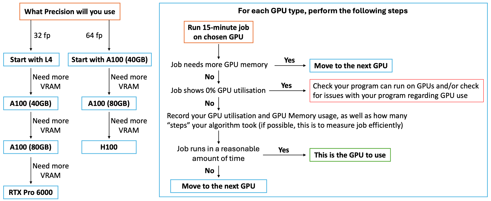

# 5. Which GPU: will it fit?

!!! clipboard-list "Lesson Objectives"

    - Work out whether your job will fit in a card's memory
    - Read an out-of-memory error, and know what to try first
    - Use the flow diagram to find the smallest card your work fits in

!!! clipboard-question "Questions"

    - How much GPU memory does my job need?
    - My job ran out of GPU memory. Do I need a bigger card?

## GPU memory (VRAM)

GPU memory, also known as VRAM, is the memory on the GPU board itself, and it
holds everything your program is working on there: a machine learning model's
weights, the batch being processed, the results along the way. Each card has a
different amount:

| GPU | Memory |
|---|---|
| **NVIDIA L4** | 24 GB |
| **NVIDIA A100 40 GB** | 40 GB |
| **NVIDIA A100 80 GB** | 80 GB |
| **NVIDIA H100** | 94 GB |
| **NVIDIA RTX PRO 6000** | 96 GB |

Unlike CPU memory (RAM), which you ask for with `--mem`, you cannot ask for
VRAM. You get all of it, on whichever card you chose. So it is important to
choose the card that fits your work:

* Avoid asking for a card with far more VRAM than you need.
* If you only need 18 GB of VRAM, for example, an L4 is the right card.
  Asking for any other would be a poor use of resources.

!!! note "Two GPUs is not more memory"

    Two 24 GB L4s are not a 48 GB card. Unless your software explicitly
    supports splitting a job across devices, the second GPU is a separate
    24 GB your job cannot reach. Most software does not.

## How much does my job need?

It is often hard to work this out exactly, and the reliable answer comes from
a short test run — [Measuring a GPU job](measuring.md) shows how to read it.
But you can get close on paper, because every number your program holds on
the GPU costs bytes:

| Format | Bytes per number |
|---|---|
| fp64 | 8 |
| fp32 | 4 |
| bf16 / fp16 | 2 |

For **training** a neural network, a rough rule is **four times the size of the
model**: the weights themselves, a gradient for each, and two optimiser states
for each (Adam, the usual optimiser, keeps two). A model with a billion fp32
parameters is 4 GB of weights, so about 16 GB to train.

That is before the **activations**, the intermediate results of each batch,
which grow with the batch size and can be larger than everything else put
together. Treat four times the model as the floor, and measure.

## Running out of GPU memory

When a job asks for more than the card has, it stops with an error worth
learning to read, because the useful part is not the part people look at:

```
CUDA out of memory. Tried to allocate 64.00 MiB (GPU 0; 23034 MiB total
capacity; 22050 MiB already allocated; 512 MiB free).
```

| Phrase | Means |
|---|---|
| `Tried to allocate` | The allocation that failed — often small |
| `total capacity` | What the card has |
| `already allocated` | What **your process** was holding |
| `free` | What was left |

!!! note "The failed allocation is usually small"

    People see "Tried to allocate 64 MiB" and assume something strange has
    happened, because 64 MiB is nothing. The card was already 96% full; 64 MiB
    was the straw. **The number that matters is `already allocated`.**

### What to do when it does not fit

In this order:

1. **Check that it is not a leak.** If GPU memory climbs a little with every
   step instead of staying level, the job is holding on to something it has
   finished with, and no card is big enough.
   [Running interactive sessions](interactive-sessions.md) has you watch
   both kinds of crash happen.
2. **Use a smaller batch, or a lower precision**, if your software lets you
   choose and your work can tolerate it. Halving the batch roughly halves the
   activations, and bf16 halves everything stored in it
   ([Which GPU: precision](precision.md)). Both change the work, so check
   your results still hold.
3. **Otherwise, move to the next card up.** VRAM comes only with the card;
   there is no other way to ask for more.

Adding `--mem` will not help. That is CPU memory
([How much CPU memory should I request?](cpu-memory.md)).

The files for this chapter are in `~/gpu-training/gpu-memory`, and also
[on GitHub](https://github.com/nesi/reannz-intro-gpu-workshop/tree/main/examples/gpu-memory){: target="_blank" rel="noopener" } to read outside the training environment.

!!! dumbbell "Exercise: fill a GPU until it refuses"

    ```bash
    cd ~/gpu-training/gpu-memory
    sbatch vram.sl
    ```

    It finishes in a few seconds. Read its output file, `vram-<JobID>.out`:

    1. In the first part, which counter moves when the script puts data in
       RAM, and which when it moves the data to the GPU?
    2. In the table, how much memory would a 1 billion parameter model need
       to train in fp32?
    3. At the end, find the out-of-memory error. How much did it try to
       allocate, and how much was already allocated?

    ??? "What you should see"

        1. Putting 32 MB in RAM moves only the RAM column. Moving it to the
           GPU moves only the VRAM column. Freeing the RAM copy changes
           nothing on the GPU. **Two pools, not connected.**
        2. About 15 GB: 3.7 GB of weights, times four.
        3. The card filled 12 MB at a time, then:

            ```
            CUDA out of memory. Tried to allocate 12.00 MiB (GPU 0; 195.00 MiB
            total capacity; 192.00 MiB already allocated; 3.00 MiB free).
            ```

            A small allocation, on a card that was already full — the straw,
            not the load.

---

## Choosing your card

Memory and precision together decide the card. The figure below is the method:

{: .center}

1. Determine which precision you need ([Which GPU: precision](precision.md)).
   This decides which GPUs to try, and the order to try them in.

2. Perform 15-minute test jobs on each GPU, in that order, until one is right:

    1. **Did the job run out of GPU memory?** Check that it is not a leak
       (above), then move to the next GPU up the ladder.
    2. **Is the GPU sitting at 0% utilisation?** Stop climbing — your program
       is not using the GPU at all, and a bigger one will not change that
       ([Is it really using the GPU?](using-the-gpu.md)).
    3. **Record your GPU utilisation, GPU memory and step count.** Do this
       before deciding anything, while the numbers are in front of you.
    4. **Are you happy with how long the calculation took?** If yes, **this is
       your card** — stop here. If not, move up one rung and run the 15
       minutes again.

!!! note "Why record the numbers before you decide"

    Step 4 is a judgement, and it is much easier to make with the previous
    rung's figures written down. "Is this fast enough?" is hard to answer in
    the abstract; "is this enough faster than the L4 to be worth the queue?" is
    not.

    [Measuring a GPU job](measuring.md) covers reading those numbers off a
    finished job with `seff`, and the step count is what sets `--time` in
    [Putting it all together](putting-it-together.md).

If you would like a second opinion, [`pick_a_gpu.py`](https://github.com/nesi/reannz-intro-gpu-workshop/blob/main/examples/gpu-memory/pick_a_gpu.py){: target="_blank" rel="noopener" } in the same
folder asks the same questions and prints a request: `python3 pick_a_gpu.py`.

!!! graduation-cap "Keypoints"

    - **There is no flag for GPU memory** — you get all of whatever card you
      asked for, and two GPUs do not give you more.
    - Estimate on paper — about **four times the model** to train, plus the
      activations — then measure a short run.
    - The useful number in an out-of-memory error is **`already allocated`**,
      not "tried to allocate".
    - When a job runs out: **rule out a leak**, then a smaller batch or lower
      precision, then the next card up. `--mem` never helps.
    - Take the **smallest card that fits** — shorter queue, fairer share, same
      result.
