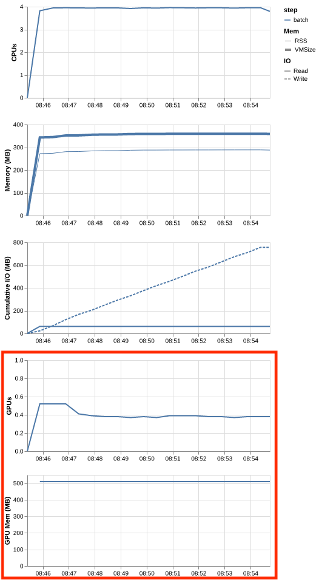

# 8. Measuring a GPU job

!!! clipboard-list "Lesson Objectives"

    - Set up a short test job that starts straight away
    - Turn on Slurm's profiling, so there is something to look at afterwards
    - Read a finished job with `seff`, and its shape over time with
      `profile_plot`
    - Watch a running job's GPU with `nvtop`

!!! clipboard-question "Questions"

    - How do I run a test job without waiting all day for it?
    - Which command tells me what the GPU actually did?

The last four chapters were about what to ask for. Each one ended the same
way — the only reliable answer comes from measuring:

| Decision | How you settle it | Where |
|---|---|---|
| Which GPU | Climb the ladder until the job fits and runs fast enough | [Which GPU: will it fit?](gpu-memory.md) |
| How many CPUs | Add cores until GPU utilisation stops climbing | [How many CPUs](how-many-cpus.md) |
| How much RAM | Measure the peak, then add 20–30% | [How much CPU memory](cpu-memory.md) |

All three come down to one method: **run something short, then look at what
it did.** This chapter is the tools that make that possible.

## A submit script for testing

A test job is not a normal job. You want it to start **now**, run **briefly**,
and record **everything** — none of which you want for production work.

```bash
#!/bin/bash -e
#SBATCH --job-name      gpu-test
#SBATCH --account       nesi99991
#SBATCH --time          00:15:00    (1)
#SBATCH --qos           debug       (2)
#SBATCH --gpus-per-node l4:1
#SBATCH --cpus-per-task 4
#SBATCH --mem           32GB
#SBATCH --profile       task        (3)
#SBATCH --acctg-freq    1           (4)
#SBATCH --output        gpu-test-%j.out

# your program here
```

1. **Fifteen minutes.** Long enough for the job to settle into its normal
   rhythm, short enough that a bad guess costs you very little.
2. **Debug priority**, so the test starts within minutes.
3. **Profile this job**, so Slurm records what it did over time.
4. **Sample once a second**, rather than the much coarser default.

The last three lines exist only for testing. **Take them out of your
production scripts.**

### `--qos debug` — jumping the queue

The debug QoS raises your job's priority so that it starts quickly, in return
for strict limits on its size and length. It is meant for exactly this kind of
one-off test:

```bash
#SBATCH --qos debug
#SBATCH --time 00:15:00
```

You can only have one debug job at a time. The
[Debug QoS](https://docs.nesi.org.nz/Batch_Computing/Debug_QoS/) page has the
limits, and what it must not be used for.

### `--profile task` and `--acctg-freq 1` — recording what happened

`--profile task` tells Slurm to measure the CPU, GPU and memory your job uses
over time, rather than only summing it up at the end. `--acctg-freq 1` tells
Slurm to take those measurements every second.

```bash
#SBATCH --profile task
#SBATCH --acctg-freq 1
```

## Watching a running job

Once your test job is running, you can watch its GPU live:

1. Find its job ID with `squeue --me`.

    ```bash
    user.name@login03:$ squeue --me
    JOBID         USER     ACCOUNT   NAME        CPUS MIN_MEM PARTITI START_TIME     TIME_LEFT STATE    NODELIST(REASON)
    1234567       user.nam nesi99999 Example_GPU_   8     24G genoa   Apr 30 17:36    23:58:08 RUNNING  g09
    ```

2. Step onto the node the job is running on with `svisit <JobID>`.

    ```bash
    user.name@login03:$ svisit 1234567
    user.name@g09:$
    ```

3. Run `nvtop`, which shows the job's GPU utilisation and memory as they
   happen.

    {: .center}

Press `q` to quit `nvtop`, and `exit` to come back to the login node.

## Reading a finished job

### `seff`: one number per resource

Once the job has finished, `seff` summarises what it used:

```bash
seff <JobID>
```

For a fifteen-minute test on an L4, it looks like this:

```
Job ID: 1234567
State: TIMEOUT
Tasks: 1
Cores: 4
Job Wall-time:        100%  00:15:04 of 00:15:00 time limit
Avg CPU Utilisation:   98%  00:59:20 of 01:00:16 core-walltime
Peak Mem Utilisation:   1%  284.46 MB of 32.00 GB
Peak GPU Utilisation:  43%
Peak GPU Memory Util:   2%  510.00 MB of 24 GB
```

Read it against the decisions you made:

| Line | What it is telling you | Which request it judges |
|---|---|---|
| **Job Wall-time** | How much of your time limit you used | `--time` |
| **Avg CPU Utilisation** | How busy the cores you asked for were | [`--cpus-per-task`](how-many-cpus.md) |
| **Peak Mem Utilisation** | Peak CPU memory against what you asked for | [`--mem`](cpu-memory.md) |
| **Peak GPU Utilisation** | How much of the job the GPU was working | [`--cpus-per-task`](how-many-cpus.md), and your code |
| **Peak GPU Memory Util** | Peak GPU memory against what the card has | [`--gpus-per-node`](gpu-memory.md) |

**No GPU lines at all means the job had no GPU.**

### `profile_plot`: the same job, over time

`seff` gives one number per resource, and for utilisation that number is an
average over the whole job, whatever the "Peak" in its name suggests. A job
holding a steady 40% and a job swinging between 100% and 0% both average 40%,
and they have completely different causes. To tell them apart, plot the job
over time. Because the test script used `--profile task`:

```bash
profile_plot <JobID>
```

This writes a file called `<JobID>_profile.png`, which looks something like
this:

{: .center}

| Panel | What it shows |
|---|---|
| **CPUs** | How many cores were actually in use |
| **Memory (MB)** | `RSS` — real memory held — and `VMSize`, the address space reserved |
| **Cumulative I/O (MB)** | Bytes read (solid) and written (dashed), adding up over the run |
| **GPUs** | GPU utilisation, as a fraction of one card |
| **GPU Mem (MB)** | How much GPU memory the job was holding |

## Try it

The files for this chapter are in `~/gpu-training/measuring`, and also
[on GitHub](https://github.com/nesi/reannz-intro-gpu-workshop/tree/main/examples/measuring){: target="_blank" rel="noopener" } to read outside the training environment.

!!! dumbbell "Exercise: a test job, measured"

    **Submit it.** It runs for three minutes.

    ```bash
    cd ~/gpu-training/measuring
    cat test-job.sl
    sbatch test-job.sl
    ```

    **Watch it while it runs.**

    ```bash
    squeue --me
    svisit <JobID>
    nvtop
    ```

    Press `q`, then `exit`, once you have seen the shape.

    **Read it once it has finished.**

    ```bash
    seff <JobID>
    profile_plot <JobID>
    ```

    Open `<JobID>_profile.png` from the JupyterLab file browser.

    ??? "What you should see"

        In `nvtop`, GPU utilisation rises and falls on a regular beat: twenty
        seconds of work, ten seconds of waiting. Then `seff`:

        ```
        Job ID: 1006
        State: COMPLETED
        Tasks: 1
        Cores: 2
        Job Wall-time:         20%  00:03:03 of 00:15:00 time limit
        Avg CPU Utilisation:   67%  00:04:05 of 00:06:07 core-walltime
        Peak Mem Utilisation:  13%  522.78 MB of 4.00 GB
        Peak GPU Utilisation:  65%
        Peak GPU Memory Util:  32%  65.00 MB of 200 MB
        ```

        The job used three of its fifteen minutes, and about two thirds of
        the GPU — which `seff` reports as a single 65%. The plot shows where
        that number comes from: the GPU panel is a sawtooth, high for twenty
        seconds and idle for ten. That shape is what an average hides.

!!! graduation-cap "Keypoints"

    - A test job wants **`--time 00:15:00` and `--qos debug`** so it starts
      straight away. Take the debug QoS out again afterwards.
    - **`--profile task` with `--acctg-freq 1`** records what the job did second
      by second. Testing only — never in a production script.
    - **`seff <JobID>`** after the job gives one number per resource, and each
      one judges a request you made.
    - **`profile_plot <JobID>`** turns that into a graph over time. The average
      and the shape are different information.
    - **`squeue --me` → `svisit <JobID>` → `nvtop`** to watch a job live.
